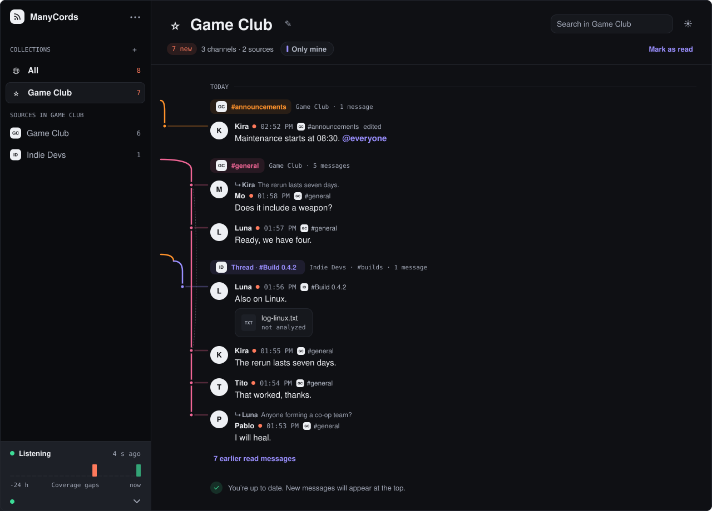

# ManyCords

The Discord server channels you choose, in one quiet reader. A Chrome and Firefox
extension that keeps what your open Discord tab receives, on your own device, so you
can catch up on many channels in one place instead of clicking through them.

> [!IMPORTANT]
> **What it does, and what it does not.**
> - It saves only what your own open Discord tab receives, and only from the channels in your collections. It never fetches history, opens its own connection, navigates or scrolls for you.
> - **Direct messages are never saved.**
> - Everything stays in your browser profile. No server, no account, no analytics, no sync. The only requests it makes are images from Discord's CDN (avatars, server icons, thumbnails).
> - Marking something as read changes this reader only, never Discord.
>
> **Capturing Discord from the browser is not authorised by Discord and may violate Discord's [terms of service](https://discord.com/terms). Your account could be restricted or suspended. Use at your own risk.** ManyCords is not affiliated with or endorsed by Discord Inc.

## What you are looking at

![The reader annotated with nine numbered parts: collections with unread counts, the sources in the open collection, the capture status dot, Only mine, Mark as read, one coloured lane per channel with a thread branching off its parent, a reply quote, the unread dot, and where a message came from. Below, what gets saved: two collections pick four channels, so those four and the thread under one of them are saved, three other channels are not, a direct message never is, and the starting All collection, which saves every server channel, has been deleted](docs/images/anatomy.svg)

## Get it

ManyCords is not in the Chrome Web Store or Firefox Add-ons yet. Each
[GitHub release](https://github.com/MarioPayan/manycords/releases/latest) carries
ready-built zips, so you need neither Node nor a clone.

**Chrome**

1. Download `discord-feed-chrome-<version>.zip` from the latest release and extract it to a folder you will keep: Chrome loads the extension from that folder on every start.
2. Open `chrome://extensions`, turn on **Developer mode**, choose **Load unpacked** and select the extracted folder (the one with `manifest.json`).
3. To update, replace the folder's contents with the newer zip and press the extension's reload button. Captured data is kept.

**Firefox 128 or newer**

Download `discord-feed-firefox-<version>.zip`, extract it, open
`about:debugging#/runtime/this-firefox`, choose **Load Temporary Add-on** and select its
`manifest.json`. Firefox removes temporary add-ons when it restarts; a permanent install
needs a build signed by Mozilla.

**Then** open or reload a Discord tab and click the ManyCords toolbar button. The welcome
screen explains what is captured and the terms risk; after **I understand** it walks you
through waiting for the green signal and creating your first collection. Keep the Discord
tab open: only activity it receives while open is saved.

Each browser keeps its own data; nothing syncs between computers. A store version, once
published, will be a separate extension with its own storage, so remove the unpacked copy
when you switch. Prefer to build it
yourself? [Load it from source](docs/development.md#load-the-extension-from-source).

## Why

| | |
|---|---|
| **Only what you chose** | Collections pick channels across servers, and the union of them is what gets saved, threads included. The starting “All” collection saves every server channel until you delete it |
| **Never your DMs** | A message without a server is dropped before anything is stored |
| **Passive** | It reads the gateway frames your Discord tab already decodes. It never calls Discord's API, fetches history, or clicks and scrolls for you |
| **Stays on your device** | Messages live in your browser's IndexedDB, kept 14 days by default (7, 30 or forever in the menu), exportable as JSON. No `fetch`, XHR or WebSocket anywhere in the extension's code |
| **Honest about gaps** | The status dot goes yellow, then red, when the signal stops, and a 24-hour chart marks the stretches it may have missed |
| **Yours first** | **Only mine** shows mentions of you, replies to you and your keywords; a toolbar badge counts them and local notifications can tell you |
| **Small** | Plain JavaScript and HTML, no runtime dependencies, no bundler: 1,940 lines in nine files, a 108 KB release zip. English and Spanish |

How those numbers were measured: the line count is `wc -l` over the nine shipped code
files (`hook.js`, `relay.js`, `background.js`, `db.js`, `gaps.js`, `mine.js`,
`threads.js`, `viewer.js`, `viewer.html`) at v0.2.1; the zip is the size of
`discord-feed-chrome-0.2.1.zip` on the v0.2.1 release (110,791 bytes, fonts and icons
included); “no `fetch`, XHR or WebSocket” is a grep of those same files.

## More

- **[How it works](docs/how-it-works.md)**: the files, what is captured and stored, capture health, and every reader rule.
- **[Developing and publishing](docs/development.md)**: building from source, the tests, the README images, and the release checklist.
- **[Privacy policy](https://mariopayan.github.io/manycords/privacy.html)** ([español](https://mariopayan.github.io/manycords/privacy.es.html)) and the [product page](https://mariopayan.github.io/manycords/).
